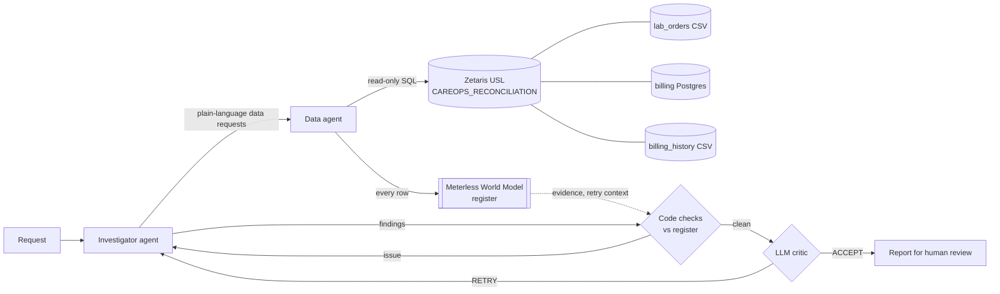

# CareOps Reconcile AI

**A multi-agent system that reconciles completed lab orders against billing across fragmented hospital systems, verifies its own evidence, and hands a structured report to a human reviewer.**

Open Agent Hackathon 2026 · Track: *Solving Fragmented Intelligence* · Zetaris (data layer) · Meterless World Model engine + Nightshift provider · NVIDIA Nemotron · LangGraph. All data is synthetic.

---

## Quick start

```bash
cp .env.example .env                      # fill in Zetaris + Nightshift (or NVIDIA) settings
pip install -r requirements.txt           # or: uv sync
python scripts/setup_zetaris.py           # once: load + register the synthetic data in your Zetaris
docker compose up --build                 # API + web UI on http://localhost:8000
```

Call it:

```bash
curl -X POST http://localhost:8000/run -H "Content-Type: application/json" -d @input_examples/example_2.json
```

No Zetaris, no model, no network? Sample mode still runs the pipeline:

```bash
docker build -t careops .
docker run --rm --network none -e SAMPLE_MODE=true careops python run.py "Check order L103"
```

Without Docker: `uv sync && (cd ui && npm ci && npm run build) && uv run python run.py` (Python 3.12, [uv](https://docs.astral.sh/uv/), Node 20+).

## The problem

A hospital keeps related facts in separate systems:

| System | Holds | Here |
|---|---|---|
| Lab | which tests were done | CSV in Zetaris (`HOSPITAL_RECON.lab_orders`) |
| Billing | invoices and payment state | separate PostgreSQL (`BILLING_POSTGRES.billing_records`) |
| Billing history | cancellations, replacements | CSV in Zetaris (`HOSPITAL_RECON.billing_history`) |

No single system can answer "was every completed test billed correctly?". The traps are what a naive check gets wrong: a missing invoice may exist in a system we cannot see; two invoices for one order may be a **cancellation plus a valid replacement**, not duplicate billing; unpaid is not the same as incorrect. CareOps investigates, explains what the evidence supports, states its uncertainty and flags cases for a human. **It never changes billing records.**

## How it works



| Agent | Role |
|---|---|
| **Orchestrator** (LangGraph) | Runs attempts, routes critic feedback back to the investigator, stops at 3 attempts or the run's time budget |
| **Investigator** | Plans the data it needs, asks the Data agent in plain language (never writes SQL), writes findings with evidence under the business rules |
| **Data agent** | Writes read-only SQL over one Zetaris USL table that already joins the three sources; returns Zetaris' rows unchanged |
| **World Model** (Meterless engine) | Per-run register of every row, derived link, finding and verdict, with provenance and an audit log |
| **Critic, code checks** | Verifies every evidence item against the register: record exists, column was retrieved, value matches, invoice belongs to the order, business rules hold. Failure → concrete fixes back to the investigator, LLM critic skipped |
| **Critic, LLM** | Judges what code cannot: explanation follows from evidence, candidate vs confirmed, replacement vs duplicate, coverage. ACCEPT or RETRY |

On RETRY the investigator receives the critic's issues **plus the deduplicated data already in the register**, so it fixes them without re-querying. Each finding carries: order, finding type, invoice ids, evidence (each item marked verified or not), explanation, confidence, uncertainty, recommended action, and whether human review is required.

## Entry points

| How | Command |
|---|---|
| HTTP, synchronous | `POST /run` — JSON in, JSON out (below) |
| One-off run | `python run.py "question"` or `python run.py --input input_examples/example_1.json` → JSON on stdout, exit 0/1 |
| Server | `python run.py` → API + web UI on `$HOST:$PORT` (default `0.0.0.0:8000`) |
| CLI, readable output | `uv run careops investigate "question"` |
| Web UI | `/` — start runs, watch the live timeline, read reports and the World Model register |

`POST /run` request:

```json
{"run_id": "demo-001", "input": {"query": "Check order L103: duplicate billing or a valid replacement?"}, "options": {"sample_mode": false}}
```

Response (abridged; full examples in [`output_examples/`](output_examples/)):

```json
{
  "run_id": "demo-001",
  "status": "success",
  "output": {
    "summary": "VERIFIED after 1 attempt(s): 1 order(s) reviewed, 8/8 evidence items verified against Zetaris. Needs human review: L103 (unpaid replacement invoice).",
    "verification_status": "VERIFIED",
    "stop_reason": "accepted",
    "findings": [{"order_id": "L103", "finding_type": "UNPAID_REPLACEMENT_INVOICE", "evidence": [{"invoice_id": "I104", "field": "notes", "value": "Replacement for I102", "verified": true}], "...": "..."}],
    "recommendations": [{"order_id": "L103", "action": "Check payment status of I104 with the billing team.", "requires_human_review": true}],
    "critic_history": [{"number": 1, "verdict": "ACCEPT", "decided_by": "llm", "issues": []}],
    "artifacts": ["reports/demo-001.json", ".world/demo-001.json", "logs/trace-demo-001.jsonl"]
  },
  "agents": [{"name": "Investigator", "role": "..."}],
  "trace_id": "demo-001",
  "log_file": "logs/trace-demo-001.jsonl",
  "execution_time_seconds": 134.2
}
```

Failures return `{"status": "error", "error": {"type", "message", "recoverable"}, ...}` (HTTP 502), never a crash. A busy server returns 409. A `run_id` that was used before gets a suffix (`example-1-2`), and the response says which id was used. `GET /health` reports the model in use and why.

## Read-only by design

CareOps never changes data. Zetaris is queried with `SELECT` only (Zetaris restricts that endpoint, and the client rejects anything else), and nothing writes to the billing systems.

A request to change data, such as *"Delete invoice I102"*, *"mark I104 as paid"* or `DELETE FROM billing_records ...`, is refused before any agent, model or Zetaris call ([`app/write_guard.py`](app/write_guard.py)). It still gets a normal response, report, trace and UI entry, with status `REFUSED`:

```json
{"status": "success", "output": {"verification_status": "REFUSED", "findings": [],
 "summary": "This system is read-only. It investigates lab orders and billing and recommends actions for a human, but it never changes, deletes or creates records in any system. Nothing was changed. ..."}}
```

Questions about changes (*"Which invoices were cancelled?"*, *"Should I106 be cancelled?"*) still run. The web UI's example list includes one write request to try.

## Sample mode

`SAMPLE_MODE=true` (or `"options": {"sample_mode": true}`, or the UI toggle) runs without Zetaris, a model or network access:

- Zetaris → [`data/sample_usl_rows.json`](data/sample_usl_rows.json), the USL table's synthetic rows exactly as Zetaris returns them
- LLM investigator → a deterministic rule-based stand-in applying the same business rules
- LLM critic → skipped; the verdict comes from the code checks
- **Real:** the World Model register, the code checks against it, the report and the trace

Every log line, trace record and report says when a run was in sample mode.

## Logs and traces

- **stdout** and `logs/careops-<time>.log`: readable lines tagged `run_id=...`
- **`logs/trace-<run_id>.jsonl`**: one JSON object per step, with `timestamp, run_id, agent_name, action, input_summary, output_summary, target_agent, model, retry_count, status`. It shows every handoff, Zetaris query, World Model action, critic decision, retry and model call. **Every model call records the model that answered** (e.g. `nvidia/nemotron-3.5-lightning-30b-a3b`)
- `logs/events-<run_id>.jsonl`: the raw progress events, so the web UI can show the timeline and replay the live agent-flow animation of any past run (runs from before this file existed are rebuilt from their trace)
- `.world/<run_id>.json`: the run's World Model register (event log + audit)
- `reports/<run_id>.json`: the final report

Secrets are never logged.

## Sponsor technology

**Zetaris (data layer).** The three sources are registered in Zetaris and joined in a USL logical table, `careops.CAREOPS_RECONCILIATION`. The agents query it over Zetaris' REST API (`app/adapters/zetaris_client.py`) by its USL path `lightning.metastore.careops.CAREOPS_RECONCILIATION.CAREOPS_RECONCILIATION`, through the SELECT-only endpoint; `SHOW`/`DESCRIBE` go through the general endpoint, restricted to those keywords. Agents never write cross-source JOINs: the semantic layer does the federation.

**Meterless.**
- *Engine, World Model:* `app/engines/world_model.py` is a Python port of the Meterless World Model reference implementation. It has stable content-addressed ids, provenance required on every write, an append-only event log with an audit entry per mutation, bitemporal relationships, facts with conflict policies, idempotent ingest, and graph/facts/snapshot views. **It is in the main feature, not a side demo:** it is each run's register, the evidence base of the critic's code checks, and the source of the retry context. The official conformance runner only loads TypeScript modules, so **its 8 checks were ported to pytest with the same inputs and assertions; 8/8 pass**: `uv run pytest tests/test_world_model.py`.
- *Nightshift, primary AI provider:* `app/adapters/meterless.py` implements provider contract v4: `meterless/*` routing modes from `/v1/models`, Bearer token (`rt-local` rejected), `meterless-app`/`meterless-scope` headers, URL normalisation, connect links, Auto Detect, and a 180 s timeout. With `METERLESS_BASE_URL`/`METERLESS_RUNTIME_TOKEN` set and the runtime online, every agent runs through it (`METERLESS_MODEL`, default `meterless/auto`). If Nightshift is configured but unreachable, the app falls back to NVIDIA's hosted API and **logs the fallback and its reason**. *Our dev machine is Ubuntu x86_64 without a GPU, for which Nightshift has no build. As the organisers advised, our recorded runs use NVIDIA's hosted API directly, and the provider is tested against a fake runtime that follows the contract* (`tests/test_meterless.py`).

**NVIDIA Nemotron.** All agents run on `nvidia/nemotron-3.5-lightning-30b-a3b`, the model named on every `model_call` record in the traces. It is a reasoning model, so replies get a 16k-token budget. A reply that runs out comes back empty (`finish_reason=length`); this is logged and answered with one in-conversation reminder, not a full retry.

**LangGraph / LangChain / LangSmith.** LangGraph runs the investigate → critique → retry state machine; LangChain `create_agent` builds the agents; LangSmith tracing is optional (`LANGSMITH_*`).

## Bounded runs

| Limit | Value |
|---|---|
| Zetaris request | 60 s timeout |
| Model request | 240 s (NVIDIA), 180 s (Nightshift: a model load can take minutes). If the Critic Agent's call still fails, the run ends `INCONCLUSIVE` with `stop_reason: "critic unavailable (...)"` and keeps the code-checked findings, instead of failing |
| Attempts | 3 (1 + 2 critic-driven retries) |
| Whole run | `RUN_TIMEOUT_SECONDS` (600): no new attempt starts after it; the run ends `INCONCLUSIVE` with `stop_reason: "time budget"` |
| Rows per query | 200; truncation is flagged in the evidence |

Typical runs take 2–5 minutes on the hosted API.

## Configuration

See [`.env.example`](.env.example). Main settings: `ZETARIS_REST_URL`/`ORG_ID`/`API_KEY` or `ZETARIS_BASE_URL`/`USERNAME`/`PASSWORD`; `BILLING_DB_PASSWORD`; `METERLESS_BASE_URL`, `METERLESS_RUNTIME_TOKEN`, `METERLESS_MODEL`; `NVIDIA_API_KEY` (fallback only); `CAREOPS_MODEL` (force a model); `SAMPLE_MODE`, `LOG_LEVEL`, `HOST`, `PORT`, `RUN_TIMEOUT_SECONDS`, `CAREOPS_HOME` (where `logs/`, `reports/`, `.world/` go).

Zetaris can be reached two ways: the setup guide's REST API with an API key (`ZETARIS_REST_URL`, `ZETARIS_ORG_ID`, `ZETARIS_API_KEY`, used when the key is set) or the web interface sign-in (`ZETARIS_BASE_URL`, `ZETARIS_USERNAME`, `ZETARIS_PASSWORD`). Agents use the SELECT-only endpoint either way.

Inside Docker, Zetaris and Nightshift are on the host: `docker-compose.yml` points the app at `host.docker.internal` (`:8888` REST, `:3000` web, `:8088` Nightshift) and maps that name on Linux. **Linux note:** the standard Zetaris bundle binds its REST port 8888 to `127.0.0.1`, which a container cannot reach; there, leave `ZETARIS_API_KEY` empty to use the sign-in route on port 3000, or run without Docker.

## Data

All data is synthetic, created for this project (licence: same as this repository); no real patient or financial records. The source files are in [`data/`](data/):

| File | Source system it plays | Registered in Zetaris as | Rows |
|---|---|---|---|
| [`lab_orders.csv`](data/lab_orders.csv) | lab system (files) | `HOSPITAL_RECON.lab_orders` (Lightning filestore, CSV) | 8 orders, L101–L108 |
| [`billing_records.sql`](data/billing_records.sql) | billing system (PostgreSQL 16) | `BILLING_POSTGRES.billing_records` (JDBC datasource) | 9 invoices, I101–I109 |
| [`billing_history.csv`](data/billing_history.csv) | billing history (files) | `HOSPITAL_RECON.billing_history` (Lightning filestore, CSV) | 3 events: I102 cancelled and replaced by I104; I107 cancelled |

The agents query one Unified Semantic Layer table over all three, `lightning.metastore.careops.CAREOPS_RECONCILIATION.CAREOPS_RECONCILIATION` (11 string columns), activated as `lab_orders LEFT JOIN billing_records ON order_id LEFT JOIN billing_history ON order_id AND invoice_id`. Its ten rows are also bundled as [`sample_usl_rows.json`](data/sample_usl_rows.json) for sample mode.

The data is messy on purpose, the way exports from separate systems are, and each order tests one case:

| Order | What the data says | Expected finding |
|---|---|---|
| L101, L104 | one invoice, issued and paid | RECONCILED |
| L102 | completed, no invoice anywhere | MISSING_INVOICE_CANDIDATE (medium: it may exist elsewhere) |
| L103 | I102 cancelled as a duplicate, I104 its replacement, unpaid | UNPAID_REPLACEMENT_INVOICE, not duplicate billing |
| L105 | two issued invoices, one `PAID`, one `Paid`, no history | POSSIBLE_DUPLICATE_BILLING |
| L106 | I107 cancelled, no replacement | CANCELLED_WITHOUT_REPLACEMENT |
| L107 | I108 issued, payment status `unpaid ` (lower case, trailing space) | UNPAID_INVOICE |
| L108 | its invoice I109 exists, but billing keyed it as `L-108`, so it never joins; the order date is `23/10/2026` | MISSING_INVOICE_CANDIDATE: the join cannot see I109, which is exactly why a missing invoice is never high confidence |

Statuses are compared without case and stray spaces (`PAID` = `Paid` = `paid `); evidence quotes each value exactly as Zetaris returned it.

### Data setup (one command)

With Zetaris running and admin access to it in `.env` (`ZETARIS_API_KEY`, or `ZETARIS_USERNAME`/`ZETARIS_PASSWORD`):

```bash
python scripts/setup_zetaris.py           # sets everything up; safe to re-run (skips what exists, reloads changed data)
python scripts/setup_zetaris.py --check   # just check the USL table answers
```

It follows the hackathon setup guide's Lightning SQL route, one statement at a time:

1. **Billing system:** starts a `postgres:16-alpine` container on the Zetaris Docker network (or reuses it) and reloads `data/billing_records.sql` in one transaction, so the table always matches the file. Its password is `BILLING_DB_PASSWORD`.
2. **Files:** Zetaris cannot read files on your laptop, so the script copies the two CSVs into Zetaris' shared storage, `/home/zetaris/customer-data/shared/careops/`.
3. **Registration:** `CREATE LIGHTNING DATABASE HOSPITAL_RECON`, then `CREATE LIGHTNING FILESTORE TABLE` for each CSV (Zetaris keeps a file table's rows from when it was created, so a table whose CSV has changed is dropped and re-created; the USL over it keeps working), then `CREATE DATASOURCE BILLING_POSTGRES` (PostgreSQL JDBC) and `REGISTER DATASOURCE TABLE "billing_records"`.
4. **Semantic layer:** `CREATE NAMESPACE lightning.metastore.careops`, then `COMPILE USL CAREOPS_RECONCILIATION`, then `ACTIVATE USL TABLE ... AS SELECT ...` (the join above).
5. **Check:** prints the ten rows and fails unless the (order, invoice) pairs are exactly the expected ones, including L102 and L108 with no invoice.

`--prefix t_` runs a trial under prefixed names (`t_HOSPITAL_RECON`, `t_careops`, its own container); `--prefix t_ --remove` deletes exactly that trial. `--remove` refuses to run without a prefix.

To do it by hand instead, run the same statements in the Zetaris SQL Editor (the script prints each one).

Forgot this step? The app checks at startup, in `GET /health` (`data.ready`) and before every real run: it logs a warning, the web UI shows a banner with this command, and `POST /run` returns `503 DataNotReady` within a second instead of spending minutes on model calls. Sample mode is never blocked.

## Examples

| Input | Output | Shows |
|---|---|---|
| [`example_1.json`](input_examples/example_1.json) | [`output_examples/example_1.json`](output_examples/example_1.json) | the full reconciliation: all 8 orders, VERIFIED after the code checks sent back two overconfident missing-invoice claims |
| [`example_2.json`](input_examples/example_2.json) | [`output_examples/example_2.json`](output_examples/example_2.json) | L103: replacement, not duplicate billing |
| [`example_3.json`](input_examples/example_3.json) | [`output_examples/example_3.json`](output_examples/example_3.json) | orders with no invoice: L102, and L108 whose invoice is keyed `L-108` |
| [`example_4_sample_mode.json`](input_examples/example_4_sample_mode.json) | [`output_examples/example_4_sample_mode.json`](output_examples/example_4_sample_mode.json) | the same pipeline offline |

Outputs were produced by `POST /run` on the Docker image, against the live Zetaris setup. [`output_examples/traces/`](output_examples/traces/) has their JSONL traces.

## Tests

```bash
uv run pytest            # no LLM needed; the live-Zetaris tests skip when Zetaris is not running
```

They cover the World Model conformance checks, the critic's code checks, the register wiring, the retry logic, sample mode, the `/run` contract, the trace format, the Meterless provider against a fake runtime, and the Zetaris client guards.

## Project layout

Follows the hackathon guide's suggested structure.

```text
run.py                      entry point: server, or one run -> JSON
app/                        orchestrator (LangGraph loop), service (/run contract), api, cli, report,
                            sample_mode, trace + progress (logs), write_guard (read-only refusal), data_check,
                            paths, logging_setup
app/agents/                 data_agent, investigator_agent, critic_agent, critic_checks (code checks)
app/adapters/               zetaris_client (data layer), meterless (Nightshift provider), llm (provider choice)
app/engines/                world_model (Meterless engine, Python port), careops_world (the per-run register)
data/                       the three synthetic sources + the USL rows bundled for sample mode
scripts/setup_zetaris.py    one-command data setup in Zetaris (sources, USL)
tests/                      pytest suite, incl. the World Model conformance checks
input_examples/             example requests (POST /run format)
output_examples/            their responses, plus traces/
ui/                         React (Vite) web UI, served by the API at /
logs/                       stdout copy + trace-<run_id>.jsonl + events-<run_id>.jsonl (created at run time)
Dockerfile, docker-compose.yml, requirements.txt, pyproject.toml + uv.lock, .env.example
```

## Design decisions

- **Semantic layer first.** Agents see one logical table and its business meaning, not three sources and their join keys.
- **Raw data over summaries.** The data agent returns Zetaris' rows unchanged; an LLM summary could drop columns or misstate values.
- **Code before LLM.** Anything mechanically checkable is checked in code against the register; the LLM critic only judges what needs judgement.
- **Provenance decides what counts as evidence.** Zetaris data, derived links and agent claims share one register but are never confused.
- **Bounded, cheap retries.** Issues are phrased as concrete fixes, and the data already retrieved is passed back.
- **Decision support only.** Findings recommend review or follow-up, never billing changes.

## Limitations

- A claim that follows only from a query's `WHERE` clause (e.g. "L102 is completed" from `WHERE lab_status = 'COMPLETED'` without selecting `lab_status`) is not verified by the code checks; that needs SQL parsing.
- LLM output varies run to run. The retry loop absorbs most of it, but a run can end `INCONCLUSIVE`.
- Nightshift has not run live on our machine (no Ubuntu x86_64 build); see *Sponsor technology*.
- The web server runs one investigation at a time and serves the API and UI on the same port.

## Pre-existing components (disclosure)

- **Zetaris platform** (provided by the hackathon) and its local Docker setup. The synthetic CSV and Postgres sources, Schema Store views and USL namespace were created at the start of the build window.
- **World Model engine:** a port of Meterless's reference implementation (Apache-2.0, `github.com/Meterless/Meterless`, `engines/world-model`). The conformance checks are ported from its runner. The CareOps wiring, the deviation noted in `world_model.py` (fact winners applied inside the fold) and the register-backed critic are new.
- Open-source libraries: LangChain, LangGraph, FastAPI, React, Vite.

Everything else was written during the build window (22–27 Oct 2026).
